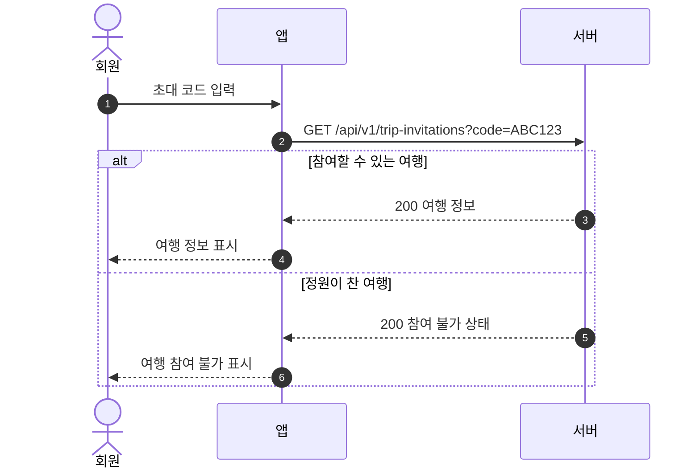
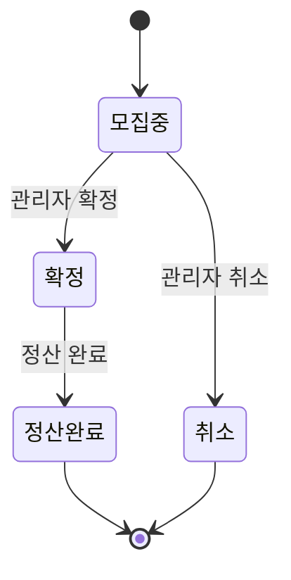
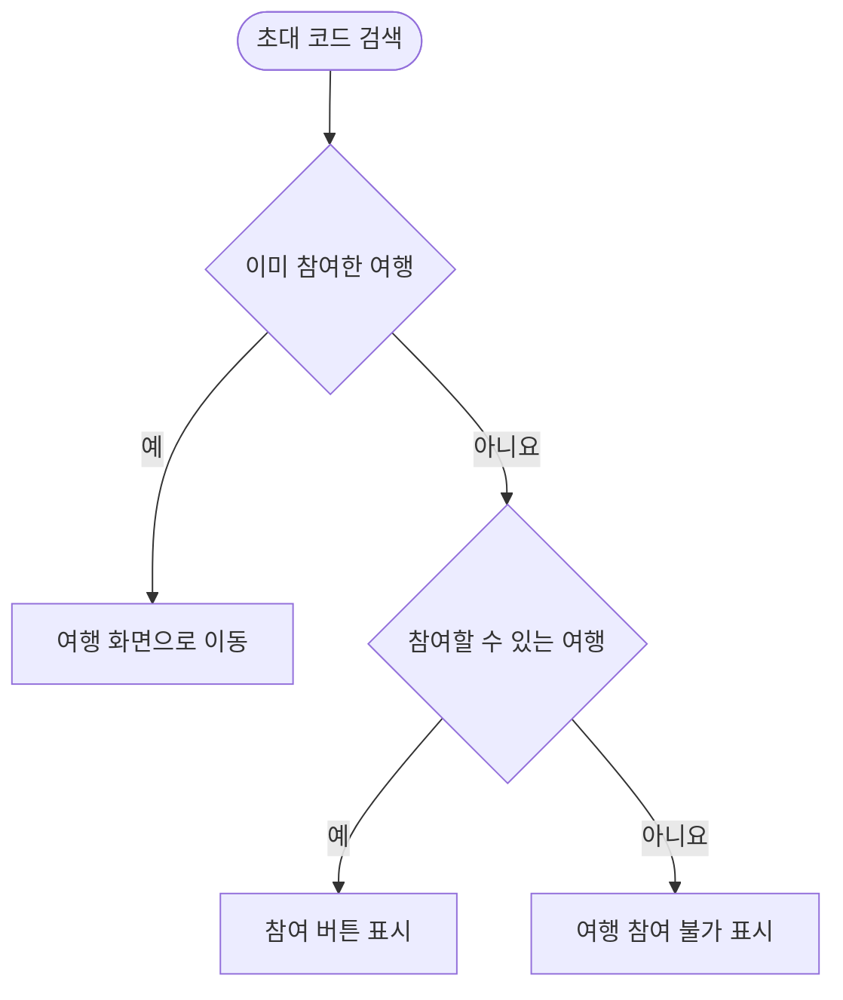

# 예시 블록

예시 블록은 설명 문단 대신 동작과 결과를 보여 주는 코드 블록이다. 블록의 종류는 결과물이 변경을 설명하는지, 현재 기준만 설명하는지로 정한다.

| 결과물 | 블록 종류 |
| --- | --- |
| PR, Issue, 코멘트, 메신저 | 변경형 |
| 바뀌는 구조를 설명하는 설명 문서 | 변경형 |
| 정책서, 기획서, API 스펙, 설계서, 규칙 가이드 | 확정형 |
| 튜토리얼, How-to, 개념을 설명하는 설명 문서 | 확정형 |

동작이 바뀌지 않는 변경에는 예시 블록을 쓰지 않는다. 문장 수정, 오탈자 수정, 이름 변경과 리팩터링이 여기에 속한다.

## 공통 규칙

- 블록 앞에는 기본 어미 문장 하나를 둔다. 이 문장에는 블록이 보여 주는 내용이나 독자가 판단할 내용을 쓴다.
- 블록 뒤에 블록의 내용을 문장으로 다시 설명하지 않는다.
- 블록 안의 설명은 사용처와 관계없이 한다체와 명사형으로 쓴다.
- 블록 하나에는 사례 하나를 쓴다. 블록의 첫 줄에는 `#` 주석으로 사례 이름을 쓴다.
- 결과에 영향이 없는 필드와 단계는 `...`으로 줄인다.
- 실제 값처럼 보이는 가상 값은 블록 앞 문장이나 사례 이름에 `가상 예시`라고 밝힌다.

## 변경형

변경형은 같은 입력에 대해 변경 전과 변경 후의 결과를 나란히 보여 준다.

- 결과물 하나에 변경형 블록은 3개까지 쓴다. 더 많은 사례는 `<details>`로 접는다.
- 변경 전은 `# As-is`, 변경 후는 `# To-be` 주석으로 표시한다.
- 변경 전에 정해진 기준이 없으면 `# As-is: 기준 없음`으로 쓴다.
- 변경 후 결과만 다르고 입력이 같으면 입력은 한 번만 쓴다.

| 변경 대상 | 블록 언어 | 형식 |
| --- | --- | --- |
| API의 요청과 응답 | `http` | 요청 한 번, As-is 응답, To-be 응답 |
| 문서 문장, 정책 문구, 설정 값 | `diff` | `-` 변경 전 줄, `+` 변경 후 줄 |
| 사용자 흐름 | `text` | As-is 시나리오, To-be 시나리오 |
| 코드의 동작 | 코드의 언어 | 함수 하나의 변경 전과 변경 후, 각각 10줄 이하 |

### API의 요청과 응답

```http
# 여행 생성: 기타 국가가 아닌데 국가명을 보냄
POST /api/v1/trips
{ "countryCode": "JP", "customCountryName": "베트남", ... }

# As-is: 기준 없음
# To-be
400 COMMON_INVALID_REQUEST
```

### 문서 문장과 정책 문구

```diff
# 기타 국가명 입력 조건
- 기타 국가명은 대표 국가가 기타일 때 입력한다.
+ 대표 국가가 기타일 때만 기타 국가명을 입력할 수 있다.
+ 대표 국가를 기타에서 다른 국가로 바꾸면 앱은 입력한 기타 국가명을 지운다.
```

### 사용자 흐름

```text
# 신규 가입자의 여행 목록 진입
As-is
1. 회원이 가입을 마친다.
2. 앱이 빈 여행 목록을 보여 준다.

To-be
1. 회원이 가입을 마친다.
2. 앱이 여행 목록 위에 초대 코드 입력 창을 띄운다.
3. 회원이 창을 닫으면 앱은 여행 목록을 보여 준다.
```

## 확정형

확정형은 현재 기준만 보여 준다. 변경 이력은 쓰지 않는다.

- `기존에는`, `이제`, `새로`, `변경되어`, `더 이상`처럼 변경을 가리키는 말을 쓰지 않는다.
- `As-is`, `To-be`, `diff` 블록을 쓰지 않는다.
- 규칙 자체는 블록이 아니라 [요구사항 문장](requirements.md)으로 쓴다. 블록은 규칙을 적용한 결과를 보여 줄 때만 쓴다.

| 보여 줄 내용 | 블록 언어 | 형식 |
| --- | --- | --- |
| 정책의 적용 사례 | `text` | 적용 예시 |
| API의 요청과 응답 | `http` | 요청 한 번과 응답 한 번 |
| 사용자의 업무 흐름 | `text` | 사용자 시나리오 |
| 시스템 사이의 호출 순서 | `mermaid` | 순서 다이어그램 |
| 상태의 전이 | `mermaid` | 상태 다이어그램 |
| 판단이 갈리는 업무 흐름 | `mermaid` | 흐름도 |
| 실행할 명령과 결과 | `bash`, `text` | 명령과 출력 |

### 적용 예시

정책이 복잡하거나 오해하기 쉬우면 규칙 아래에 적용 예시를 둔다. 사례마다 번호를 붙이고 `조건과 행동 -> 결과` 순서로 쓴다.

```text
1. 회원이 이미 참여한 여행의 초대 코드를 검색함
   -> 앱이 참여 요청 없이 여행 화면으로 이동함

2. 회원이 정원이 찬 여행의 초대 코드를 검색함
   -> 앱이 `여행 참여 불가`를 표시함
```

- 조건과 행동, 결과는 `-ㅁ`, `-음` 명사형으로 쓴다.
- 결과 줄은 `->`로 시작하고 3칸 들여 쓴다.
- 결과는 사용자가 관찰하는 결과로 쓴다.
- 경우가 5개를 넘으면 적용 예시 대신 의사결정표를 쓴다.

## 명령과 출력

튜토리얼, How-to와 트러블슈팅에서 실행할 명령은 `bash` 블록으로, 기대 출력은 바로 뒤의 `text` 블록으로 쓴다.

- 명령 블록 앞에는 `다음 명령을 실행한다.`처럼 동작 문장 하나를 쓴다.
- 명령 앞에 프롬프트 기호 `$`를 쓰지 않는다. 독자가 블록 전체를 복사해 실행하게 쓴다.
- 명령 블록 하나에는 한 단계의 명령만 쓴다.
- 명령 줄 끝의 주석은 명령이 하는 일을 명사형으로 쓴다.
- 독자마다 다른 값은 `<인스턴스 ID>`처럼 꺾쇠와 한국어 이름으로 쓴다.
- 비밀값, 토큰과 실제 계정의 Access Key를 쓰지 않는다.
- 기대 출력 블록 앞에는 `다음 출력이 나오면 이 단계를 마친 것이다.`처럼 성공 기준 문장 하나를 쓴다.
- 기대 출력은 성공을 판단하는 줄만 남기고 나머지는 `...`으로 줄인다.

```bash
terraform init    # provider를 내려받고 state 버킷에 연결함
terraform plan    # 바뀔 내용을 보여 주고 아무것도 바꾸지 않음
```

```text
...
Plan: 3 to add, 0 to change, 0 to destroy.
```

## 사용자 시나리오

사용자 시나리오는 사용자 한 명이 목표 하나를 이루는 흐름이다.

```text
# 초대 코드로 여행 참여
행위자: 회원
목표: 초대받은 여행에 참여함
사전 조건:
- 회원이 로그인함
- 초대 코드 `ABC123`의 여행이 확정 전임

기본 흐름:
1. 회원이 초대 코드 `ABC123`을 입력한다.
2. 회원이 `검색` 버튼을 누른다.
3. 앱이 여행명, 기간과 참여 인원을 보여 준다.
4. 회원이 여행방 닉네임을 입력한다.
5. 회원이 `이 여행 참여하기` 버튼을 누른다.
6. 앱이 여행 화면으로 이동한다.

대안 흐름:
3a. 회원이 이미 참여한 여행이면 앱은 참여 요청 없이 여행 화면으로 이동한다.
3b. 여행이 확정 상태이거나 정원이 찼으면 앱은 `여행 참여 불가`를 표시하고 흐름을 끝낸다.

결과:
- 회원이 여행 참여자 목록에 있음
```

- 항목은 `행위자`, `목표`, `사전 조건`, `기본 흐름`, `대안 흐름`, `결과` 순서로 쓴다. 대안 흐름이 없으면 `대안 흐름:` 줄을 지운다.
- 행위자는 한 명이다. 행위자 이름은 [K4](controlled-korean.md#k4-주체-명시)의 주체 이름을 쓴다.
- 기본 흐름의 단계는 `<주체>가 <동작>한다.`로 쓴다. 단계 하나에 동작 하나를 쓴다.
- 기본 흐름은 10단계 이하로 쓴다. 더 길면 목표를 나눠 시나리오를 둘로 쓴다.
- 대안 흐름의 번호는 갈라지는 기본 흐름 단계 번호에 `a`, `b`를 붙인다. 문장은 `<조건>이면 <주체>는 <동작>한다.`로 쓴다.
- 사전 조건과 결과는 `-ㅁ`, `-음` 명사형으로 쓴다.
- 화면 문구와 화면 이름은 [K15](controlled-korean.md#k15-문장부호)의 표기를 따른다.

## Mermaid 다이어그램

다이어그램은 Mermaid로 쓰고 다음 3종류만 쓴다.

| 보여 줄 내용 | 다이어그램 |
| --- | --- |
| 참여자 사이의 호출과 응답 순서 | `sequenceDiagram` |
| 대상 하나의 상태 전이 | `stateDiagram-v2` |
| 판단이 갈리는 업무 흐름 | `flowchart TD` |

### 공통 규칙

- 다이어그램 앞에 다이어그램이 보여 주는 범위를 기본 어미 문장 하나로 쓴다.
- 다이어그램 안의 레이블은 명사구로 쓴다.
- 색, 스타일, 테마와 `classDef`를 지정하지 않는다.
- 참여자, 상태나 노드는 7개 이하로 쓴다. 더 많으면 다이어그램을 나눈다.
- 다이어그램이 보여 주는 흐름을 본문에서 다시 설명하지 않는다.

### 순서 다이어그램



- 첫 줄 다음에 `autonumber`를 쓴다.
- 사람은 `actor`로, 시스템은 `participant`로 선언한다. 식별자는 영어로, 표시 이름은 `as` 뒤에 한국어로 쓴다.
- 참여자는 요청이 처음 시작하는 쪽부터 왼쪽에 선언한다.
- 동기 요청은 `->>`, 응답은 `-->>`, 비동기 메시지는 `-)`로 쓴다.
- API 호출의 레이블은 메서드와 경로로, 응답의 레이블은 상태 코드와 응답 이름으로 쓴다. 그 밖의 메시지는 명사구로 쓴다.
- 조건에 따라 갈리는 흐름은 `alt`와 `else`로, 조건이 맞을 때만 일어나는 흐름은 `opt`로 쓴다. 블록의 조건은 명사구로 쓴다.
- 메시지는 20개 이하로 쓴다.
- `Note`는 쓰지 않는다. 설명이 필요하면 다이어그램 아래 본문에 쓴다.

### 상태 다이어그램



- 상태 이름은 결과물의 다른 곳에서 쓰는 상태 이름과 같게 쓰고 띄어쓰기 없이 쓴다.
- 전이 레이블은 `<주체> <사건>` 명사구로 쓴다.
- 시작과 끝은 `[*]`로 쓴다.

### 흐름도



- 시작 노드는 `([ ])`, 판단 노드는 `{ }`, 동작 노드는 `[ ]`로 쓴다.
- 판단 노드의 레이블은 물음표 없이 명사구로 쓴다.
- 판단 노드에서 나가는 선의 레이블은 `예`와 `아니요`로 쓴다.
- 방향은 `TD`로 쓴다.
