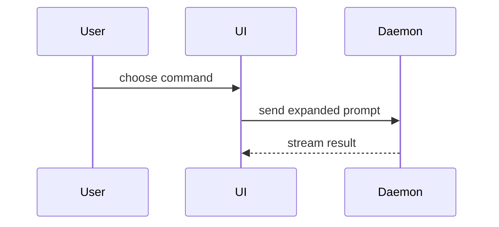

PR 본문은 이 템플릿으로 씁니다.

```markdown
## Summary

<다이어그램, diff 스케치 또는 트리>

## Evidence

- **Before:** <스크린샷, 출력 또는 실패한 테스트 실행>
  **After:** <스크린샷, 출력 또는 통과한 테스트 실행>

## Merge Danger

**Door:** <one-way 또는 two-way>

<선택: 설명>

**Blast Radius:** <한 단어 설명>

<선택: 머지의 잠재적 파급>
```

## 절

서두 인사말은 빼고 글은 짧게 씁니다. 프로젝트에 용어집이 있으면 그 도메인 용어를 씁니다. 사용자의 PR 문구 규칙(생성 도구 표기를 넣지 않는 등)이 있으면 그 규칙이 우선합니다.

### Summary

핵심을 분명히 보여 주는 가장 작은 시각 자료를 고릅니다.

- 로직이나 알고리즘은 의사 코드로 보여 줍니다.

```text
on(save)
  if content is unchanged
    return cached result
  write new content
  return fresh result
```

- 실행 시 제어 흐름은 호출 트리로 보여 줍니다.

```text
submitForm
  createSession
    persistPrompt
    launchAgent
  navigateToSession
```

- UI 구조는 컴포넌트 트리로 보여 주고, 의미 있는 상태와 모듈 경계를 포함합니다.

```text
<SessionPage> (apps/example/src/routes/session.tsx)
  useSessionEvents()
  <SessionToolbar>
    <RunSkillButton> (packages/ui)
```

- 파일의 책임이나 광범위한 리팩터링은 얕은 파일 트리로 보여 줍니다.

```text
src/
├── commands/       # parses user actions
├── sessions/       # owns session state
└── transport/      # sends API requests
```

- 컴포넌트 간 상호작용, 제어 흐름, 데이터 흐름은 Mermaid로 보여 줍니다.



- 무엇이 바뀌는지가 요점이고 주변 모양이 이미 있을 때는 `diff`를 씁니다. 주제에 맞는 diff 모양을 고릅니다.

컴포넌트 변경:

```diff
 <SessionPage>
   useSessionEvents()
   <SessionToolbar>
+    <RunSkillButton />
   <SessionTimeline>
+    <SkillResultCard />
```

파일 배치 변경:

```diff
 src/
 ├── commands/
+│   └── show-me.ts       # expands the slash command
 ├── sessions/
-└── transport.ts
+└── transport/
+    ├── client.ts
+    └── stream.ts
```

호출 트리나 호출 스택 변경:

```diff
 submitForm
   createSession
     persistPrompt
+    expandSkillMention
     launchAgent
-  navigateToSession
+  navigateToSession
+    subscribeToEvents
```

상태나 제어 흐름 변경:

```diff
 on(save)
-  write content
+  if content is unchanged
+    return cached result
+  write new content
+  invalidate cache
```

- 대부분이 새 코드일 때, 생략한 맥락이 소유 관계나 순서를 가릴 때, 사용자가 그대로 복사할 목표 모양이 필요할 때는 블록 전체를 보여 줍니다.

```ts
function expandSkill(command: string): string {
  const skillName = command.slice(1);
  return `use the ${skillName} skill`;
}
```

#### 지침

각 시각 자료는 그것이 받쳐 주는 짧은 글 바로 옆에 둡니다. 사용자의 현재 질문에 답하거나 현재 논의를 풀 선택지를 보여 주는 데 필요한 호출, 파일, props, 상태, 경계만 남깁니다.

위 형식 중 하나를 쓸 수도, 여러 개를 쓸 수도 있지만 전부 쓸 일은 드뭅니다. 판단해서 쓰고 독자를 압도하지 않습니다.

### Evidence

변경이 동작한다는 구체적인 증거입니다. before와 after를 보여 줍니다.

환경이 갖춰져 있고 변경이 시각적이라면 스크린샷이 최상급입니다.

실행 기반 증거가 그다음입니다. 테스트 결과, 콘솔 출력이 해당합니다. 이제 실패에서 통과로 바뀐 바로 그 테스트를 의사 코드로 보여 줍니다.

### Merge Danger

one-way door인지 two-way door인지 설명합니다. two-way door는 되돌아 나올 수 있지만 one-way door는 그럴 수 없습니다. 롤백 비용이 낮은 PR은 위험이 낮습니다. 파괴적인 동작이나 되돌리기 어려운 결정을 포함한 변경은 one-way door입니다.

영향 범위(blast radius)는 이 PR이 가져오는 변화의 잠재적 영향이나 범위입니다. 가능한 경우를 모두 고려합니다. 레이아웃 흔들림, 소비자 쪽 깨짐, 모바일 반응형 등이 예입니다.
